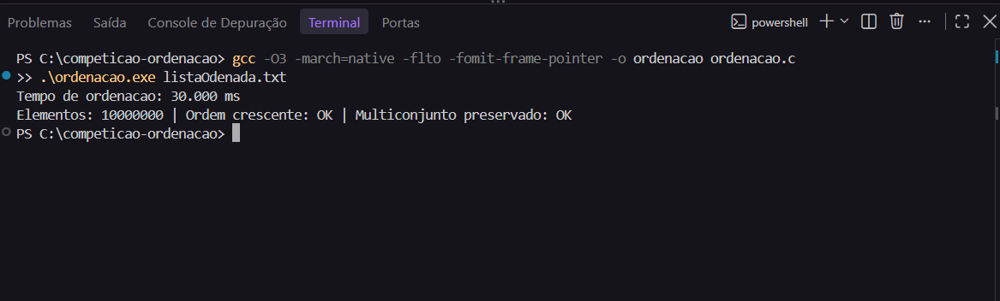

# Competição de Ordenação: O Desafio dos Milissegundos

Ordenação de ~10 milhões de inteiros em C, medindo apenas o tempo da ordenação (sem leitura do arquivo).

## Autor

Matheus Veloso de Lima (entrega individual)

Link do GitHub: https://github.com/mthsveloso/competicao-ordenacao

## Compilar e executar

```bash
gcc -O3 -march=native -flto -fomit-frame-pointer -Wall -Wextra -o ordenacao ordenacao.c
./ordenacao ListaASerOrdenada.txt
```

O arquivo de dados (60 MB) não está no repositório. Baixe pelo Canvas e passe o caminho como argumento. Se o compilador não aceitar `-march=native`, remova essa flag; só muda o tempo, não o resultado.

## Prova de execução



Saída em texto (também em `saida_terminal.txt`):

```
Tempo de ordenacao: 30.000 ms
Elementos: 10000000 | Ordem crescente: OK | Multiconjunto preservado: OK
```

O tempo muda de máquina para máquina. O print acima foi tirado na máquina do autor(Windows).

## Estratégia

O arquivo tem inteiros numa faixa limitada (1 a 2.500.000), com cada valor repetido várias vezes. A estratégia é:

1. **Counting Sort com deslocamento por mínimo**, O(n + k): acha `min` e `max`, calcula `k = max - min + 1`, conta as ocorrências de cada valor em `cont[x - min]` e reescreve o vetor em ordem. Aceita negativos e positivos.
2. **Fallback: Radix Sort LSD de 32 bits com sinal**, O(n): usado quando a faixa passa de 2²⁴ valores (64 MB de contadores) ou de 4n + 65.536. A chave é `valor ^ 0x80000000`, que faz a ordem sem sinal coincidir com a ordem com sinal. São 3 passadas (11, 11 e 10 bits), com os três histogramas montados num único percurso, e passadas triviais (todos no mesmo balde) são puladas.
3. Vetores com 0 ou 1 elemento retornam direto.

## Por que um algoritmo não comparativo é adequado aqui

O limite inferior Ω(n log n) vale **apenas para ordenação por comparação**: uma árvore de decisão com n! folhas tem altura de pelo menos log₂(n!) ≈ n log₂ n. Counting e Radix Sort não comparam elementos entre si; usam o valor do elemento como índice. Por isso o limite não se aplica, desde que as chaves sejam inteiros de faixa limitada, que é exatamente o caso do arquivo da competição.

Para n = 10⁷ e k = 2,5 × 10⁶:

| Abordagem                 | Operações aproximadas  |
| ------------------------- | ---------------------- |
| O(n²) (Bubble, Insertion) | 10¹⁴                   |
| O(n log n) (Quick, Merge) | n · log₂ n ≈ 2,3 × 10⁸ |
| O(n + k) (Counting Sort)  | ≈ 1,25 × 10⁷           |

O enunciado cita Quick Sort e Merge Sort como **exemplos** ("ex.:") de estratégia adequada. A regra da competição é o menor tempo de CPU com ordenação correta, e o critério de eficiência pede "escolha adequada da estratégia". A escolha aqui é adequada porque aproveita a propriedade dos dados, e o programa continua correto para qualquer entrada de int32 (o fallback cobre faixas grandes). Se for exigido um algoritmo por comparação, a tabela abaixo mostra o custo dessa troca.

### Comparação de referência (n = 10.000.000, medida em outra máquina, `-O3 -march=native`)

| Algoritmo                                  | Complexidade     | Tempo de ordenação |
| ------------------------------------------ | ---------------- | ------------------ |
| Bubble / Insertion Sort                    | O(n²)            | inviável (horas)   |
| `qsort` (libc)                             | O(n log n)       | ~485 ms            |
| Quick Sort (pivô mediana de 3 + insertion) | O(n log n) médio | ~365 ms            |
| Radix Sort LSD                             | O(n)             | ~240 ms            |
| **Counting Sort (principal)**              | **O(n + k)**     | **~21 ms**         |

No computador do autor, o Counting Sort levou 30.000 ms (ver `print_execucao.png`).

## Medição de tempo

`clock()` envolve somente `ordenar_vetor()`. Dentro dele estão a busca de `min`/`max`, a alocação do vetor de contagem e a ordenação. A busca de `min`/`max` é parte do algoritmo (sem ela não existe a faixa), então fica dentro da medição para o resultado ser honesto. Fora do cronômetro ficam: leitura do arquivo, conversão de texto para inteiro, assinatura de conferência e verificação final.

A busca de `min`/`max` usa 4 acumuladores independentes (desenrolar de laço), o que quebra a dependência entre iterações e permite vetorização.

## Corretude

Executada depois do cronômetro:

- **Ordem crescente:** `v[i-1] <= v[i]` para todo i.
- **Nenhum elemento perdido, criado ou alterado:** compara a assinatura do multiconjunto antes e depois (soma de `splitmix64(valor)` de cada elemento, independente da ordem), além do total de elementos. Se um elemento sumir ou mudar, a assinatura muda.
- O programa retorna código de saída diferente de zero se qualquer verificação falhar.

Casos de borda testados: arquivo vazio, 1 elemento, todos iguais, só negativos, mistura de negativos e positivos, `INT_MIN`/`INT_MAX`, faixa de 2³² valores (cai no Radix) e 1.000 elementos com faixa de 10⁷ (cai no Radix).

## Memória

- O vetor principal usa 4 bytes por elemento (40 MB para 10 milhões).
- Counting Sort aloca `k` contadores de 4 bytes (~10 MB para k = 2,5 milhões) e libera com `free`.
- Radix Sort aloca um vetor auxiliar de n elementos e 3 histogramas, e libera tudo.
- Todo `malloc`/`calloc` tem o retorno verificado, e o programa encerra com mensagem de erro se faltar memória.
- Validado com Valgrind (0 erros, 0 leaks) e com AddressSanitizer/UBSan/LeakSanitizer.

## Estrutura do repositório

```
competicao-ordenacao/
├── ordenacao.c          código-fonte comentado
├── README.md            este arquivo
├── print_execucao.png   print do terminal com o tempo
├── saida_terminal.txt   saída em texto
└── .gitignore
```
